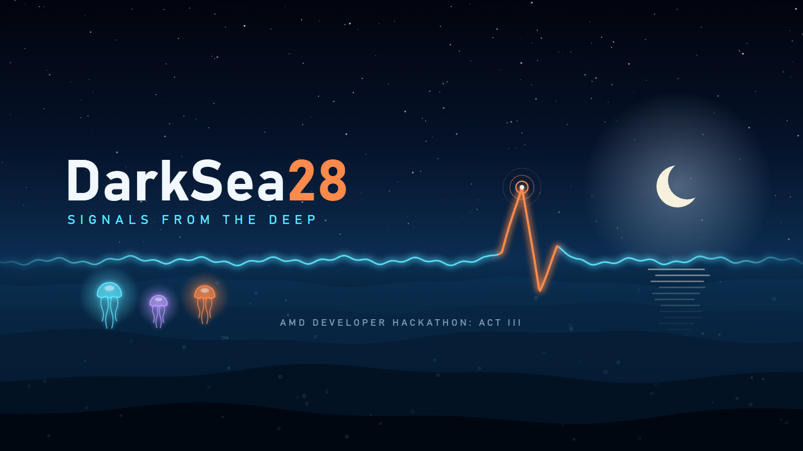
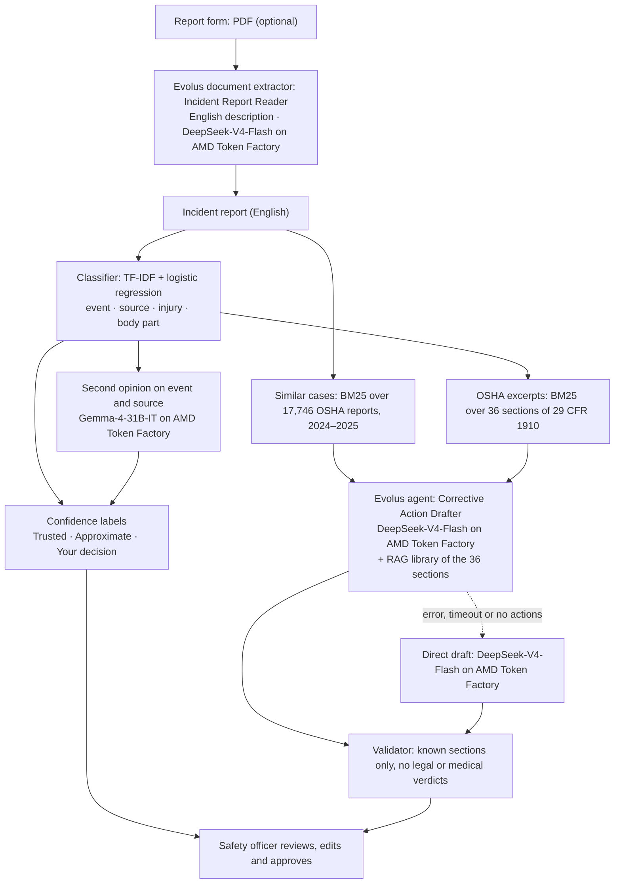

# DarkSea28 · Workplace Safety Incident Assistant

An assistant for a factory's safety officer. It turns a free-text incident report into OSHA's standard
injury codes with an honest confidence label, finds similar real OSHA cases, and drafts corrective actions
that cite OSHA standards. Where the system is unsure, a person decides.

**Live demo: <https://am-dhackathon.vercel.app>** · API health: <https://amdhackathon-production.up.railway.app/api/health>

AMD Developer Hackathon ACT III · Intelligent Industry track · Evolus track · Team DarkSea28 (Aysu, Çağrı, İlhan)

> The free API host sleeps when idle: the first visit can take up to ~45 s to connect. A live analysis takes
> 2–3 minutes because the Evolus agent searches its OSHA library before drafting. **Replay** shows a recorded
> result at once (the UI labels it as a recording).

## What it does

1. **Codes the report** into the four OIICS codes OSHA uses (event, source, injury, body part). Each code gets
   a label measured on unseen data: **Trusted**, **Approximate**, or **Your decision** (the officer picks
   from the top candidates). Source codes are never "Trusted"; the top 3 are always shown.
2. **Finds similar real cases** among 17,746 OSHA Severe Injury Reports from 2024–2025.
3. **Drafts corrective actions**, ordered by the hierarchy of controls (engineering, administrative,
   training, PPE). Each action cites one section of 29 CFR 1910 that *may be relevant*, and the excerpt is
   one click away. The draft is written by our **Evolus agent** running on **AMD Token Factory**.
4. **Validates the draft:** actions that cite unknown sections or use legal or medical verdict language
   ("violation", "diagnosis", …) are removed and listed separately.
5. **Leaves the decision to the officer:** edit or untick actions, choose the uncertain codes, approve,
   then download JSON or print. Nothing is stored.

Reports are typed in English, or uploaded as a PDF form: our **Evolus document extractor** reads the form
and fills in an English description, translating forms written in another language such as Italian. The
interface and every drafted action are in English and Italian. A **Measurement** page shows how the models
were tested, including the result that failed (see below).

## How it works



- **AMD.** Every model call runs on **AMD Token Factory** (AMD-hosted vLLM on AMD GPUs,
  `https://developer.amd.com.cn/radeon/api/v1`). Our direct calls go through one file,
  `backend/llm/token_factory.py`; the Evolus agent's model is our Token Factory connection.
  **Gemma-4-31B-IT** gives the second opinion on the event and source codes; **DeepSeek-V4-Flash** writes the
  draft (through the Evolus agent, or directly as the fallback). If one model fails, the other takes over. The
  "What ran on AMD" panel shows which models answered and how long each call took.
- **Evolus.** The draft comes from our agent in the Evolus workspace **DarkSea28**, and uploaded report forms
  are read by our Evolus document extractor (next section).
- **Local steps** (classifier, case search, excerpt search) run inside the API; the model and data slices
  ship in `deploy/bundle`, so the API starts in seconds without downloading OSHA data.

## Evolus

Workspace: **DarkSea28** (Evolus event workspace for AMD Developer Hackathon ACT III).

| Evolus building block | How we use it | In this repo |
|---|---|---|
| **Your model** | AMD Token Factory connected as our OpenAI-compatible endpoint; the agent runs on it (no platform credits) | — |
| **Specialized agent** | *Corrective Action Drafter*: drafts the actions; DeepSeek-V4-Flash, temperature 0 | `deploy/evolus/agent_instructions.md` |
| **Knowledge library (RAG)** | *OSHA 29 CFR 1910 (selected)*: the same 36 sections the API cites, indexed in English | `deploy/evolus/standards/` |
| **Document extractor** | *Incident Report Reader*: reads an uploaded PDF form and returns an English description plus date, injury, body part, equipment and language; runs on our Token Factory model and reads the PDF's text layer (no platform credits in our test) | `deploy/evolus/extractor_*` |
| **Agent chat API** | One call per report: `POST https://api.evolus.ai/v1/chat/completions`, model `<applicationId>:<agentId>`, streamed | `backend/llm/evolus.py` |
| **REST API** | Uploads the library documents and checks their indexing; sends report forms to the extractor (`/agents/{id}/json/{outputId}/ask-file`) | `backend/core/evolus_upload.py`, `backend/llm/evolus_extractor.py` |

The backend sends the agent the same prompt as the direct call: the report, the predicted codes, three
similar cases and the matching excerpts. The agent can also search its library. Sections it finds there
are accepted, and their excerpt is added to the list with the mark *found by the Evolus agent in its
library*. If Evolus returns an error, times out (`EVOLUS_TIMEOUT`) or gives no actions, the backend drafts
directly on AMD Token Factory, and the UI shows which path wrote the draft.

On the Analyze page, a PDF report form can be uploaded (or one of two sample forms written by the team, in
English and Italian, in `frontend/public/samples`). The API sends it to the extractor and puts the returned description
in the report box; the officer checks it before analysing. The upload box appears only when the extractor is
configured.

**Reproducing the Evolus setup**

1. Create an event workspace from <https://evolus.ai/en/hackathon>.
2. *Your models*: connect AMD Token Factory (OpenAI-compatible server, base URL above, your key) and test it.
3. Create a RAG library. With `EVOLUS_API_KEY`, `EVOLUS_APP_ID` and `EVOLUS_LIBRARY_ID` in `.env`, upload the
   36 files (indexing used 38 platform credits for us):
   ```bash
   python -m backend.core.evolus_upload --all     # skips files already in the library
   python -m backend.core.evolus_upload --list    # indexing status of every document
   ```
4. Create an agent: paste `deploy/evolus/agent_instructions.md` as its instructions, choose DeepSeek-V4-Flash,
   set creativity to 0 (*Precise*) and link the library. Put its id in `EVOLUS_AGENT_ID`.
5. Check one live analysis end to end; it prints whether the draft came from the agent, and why not otherwise:
   ```bash
   python -m backend.core.evolus_check            # or: evolus_check forklift | conveyor | fryer
   ```
6. Create a data extractor on the same model with `deploy/evolus/extractor_instructions.md` as its
   instructions, and give it a JSON output with the fields in `deploy/evolus/extractor_structure.json` and the
   prompt in `deploy/evolus/extractor_prompt.txt`. Put the extractor's id in `EVOLUS_EXTRACTOR_AGENT_ID` and
   the JSON output's id in `EVOLUS_EXTRACTOR_ID`.

The agent's instructions are `DRAFT_SYSTEM` in `backend/core/analyze.py`; after changing them, run
`python -m backend.core.evolus_files` and paste the regenerated file into the agent.

## Measured results

All numbers come from `reports/` and are shown on the Measurement page. Models were trained on 2024 reports
and tested once on **2025 manufacturing reports** that they had never seen. Thresholds were fixed on
validation data before the test.

| Code | Accuracy, all reports | Share labelled "Trusted" | Accuracy when "Trusted" | Errors in "Your decision" vs the rest |
|---|---|---|---|---|
| Event | 81.2% | 69.1% | **92.8%** (95% CI 91.5–93.9%) | 5.1× |
| Injury | 86.6% | 77.6% | **96.9%** (96.0–97.5%) | 15.7× |
| Body part | 84.1% | 80.0% | **94.5%** (93.4–95.4%) | 10.4× |
| Source | 63.3% | never (top 3 shown) | — | 2.6× |

- **Gemma second opinion** (pre-registered in `reports/PREREG-llm-second-opinion.md`, 500 reports from 2025).
  The pre-registered strict scoring **failed**: Gemma often answered "65: Struck by…" instead of "65", and the
  strict parser counted that as disagreement. We wrote down a parsing fix before re-scoring the same answers.
  After this declared deviation, "Trusted" for the event code when the classifier and Gemma agree reaches
  **94.4% accuracy on 71.4% of reports** (classifier alone: 91.2% on 70.4% of the same reports). We report both
  results; the re-scored one is weaker evidence. The product uses this rule only when the answer came from
  Gemma; otherwise the event code falls back to the classifier-only rule above.
- **OSHA changed its code system on 1 January 2024**: the same numbers mean different things before and after.
  The product uses only the new system. On the old system we reproduced our pre-registered brief (train
  2015–2021, test 2023 manufacturing): event 85.2% (brief 84.2%), injury 95.3% (92.6%), body part 91.2%
  (88.8%), source 68.6% (66.3%).
- **Not measured:** the corrective-action drafts. The validator only blocks unknown sections and verdict
  language; every action says a standard *may be relevant*, and the officer decides.

## Run it locally

Use **Python 3.12**. On Windows, Python 3.13.13 crashes inside asyncio as soon as SciPy's linear algebra is
loaded (access violation), which takes down the API server. The UI needs Node.js 18 or newer.

```bash
python3.12 -m venv .venv                 # Windows: py -3.12 -m venv .venv
source .venv/bin/activate                # Windows: .venv\Scripts\activate
pip install -r backend/requirements.txt
cp .env.example .env                     # Windows: copy .env.example .env, then fill it in (below)
uvicorn backend.api.main:app --port 8000
```

In a second terminal:

```bash
npm --prefix frontend install
npm --prefix frontend run dev            # http://localhost:5173, proxies /api to :8000
```

**Environment variables** (in `.env` locally, in the host's settings when deployed; never in git):

| Variable | Needed | Value | Purpose |
|---|---|---|---|
| `TOKEN_FACTORY_BASE_URL` | yes | `https://developer.amd.com.cn/radeon/api/v1` | AMD Token Factory endpoint |
| `TOKEN_FACTORY_API_KEY` | yes | your key | AMD Token Factory key |
| `LLM_MODEL` | yes | `Gemma-4-31B-IT` | Second opinion; also the direct draft's fallback |
| `LLM_FALLBACK_MODEL` | recommended | `DeepSeek-V4-Flash` | Used when `LLM_MODEL` fails |
| `LLM_DRAFT_MODEL` | no | `DeepSeek-V4-Flash` (default) | Model of the direct draft |
| `EVOLUS_API_KEY`, `EVOLUS_APP_ID`, `EVOLUS_AGENT_ID` | for Evolus | from your workspace | Without all three, the draft is written directly on Token Factory |
| `EVOLUS_LIBRARY_ID` | upload only | from your workspace | Used by `evolus_upload` |
| `EVOLUS_TIMEOUT` | no | `240` (default; the live API uses `170`) | Seconds to wait for the agent before falling back |
| `EVOLUS_ENDPOINT` | no | `chat` (default) or `ask` | Agent chat API, or the REST `/agents/{id}/ask` endpoint |
| `EVOLUS_EXTRACTOR_AGENT_ID`, `EVOLUS_EXTRACTOR_ID` | for form upload | from your workspace | The document extractor and its JSON output; without them the upload box is hidden |
| `EVOLUS_EXTRACTOR_TIMEOUT` | no | `120` (default) | Seconds to wait for the extractor |
| `VITE_API_URL` | hosted UI build | `https://<api-host>` | Where the hosted UI finds the API |

**Docker (API).** The Railway deployment builds this same `Dockerfile` (`railway.json`).

```bash
docker build -t darksea28-api .
docker run --rm -p 8000:8000 --env-file .env darksea28-api
curl http://localhost:8000/api/health    # "ok": true once the models are loaded
```

**API**

| Method | Path | Returns |
|---|---|---|
| `GET` | `/api/health` | `ok` when the models are loaded; `evolus` and `extractor` when the Evolus agent and extractor are configured |
| `POST` | `/api/analyze` | `{"text": "..."}` (20–4000 characters, English) → codes, similar cases, action plan, AMD and Evolus calls |
| `POST` | `/api/extract` | A PDF as the request body (`Content-Type: application/pdf`, ≤ 5 MB) → `{"fields": {"narrative": "...", ...}, "seconds": ...}` |
| `GET` | `/api/samples` | The four sample reports (written by the team, not OSHA records) |
| `GET` | `/api/replay/{id}` | A recorded result for a sample, labelled as a recording |
| `GET` | `/api/metrics` | Everything the Measurement page shows |

An analysis takes 1–3 minutes:

```bash
curl -X POST http://localhost:8000/api/analyze -H "Content-Type: application/json" \
  -d '{"text": "A press operator was removing a stuck part from the die by hand when the press cycled and amputated his fingertip."}'
```

## Deployment (free tiers)

- **API → Railway**: `Dockerfile`, `railway.json` (health check `/api/health`), variables as above. The service
  sleeps when idle and wakes on the first request.
- **UI → Vercel**: root directory `frontend`, `VITE_API_URL=https://<railway-domain>`. When the API cannot be
  reached, the UI still shows the Measurement page and the labelled recordings bundled in
  `frontend/public/data` (`python -m backend.core.export_static`).
- **Deployment bundle** (`deploy/bundle`, ≈ 36 MB, `python -m backend.core.bundle`): the exact measured model
  (float32 coefficients; identical top-1 on all 2,628 reports of 2025 manufacturing), the new-system case slice
  used for similar cases, and the eCFR excerpts.

## Rebuild the data, model and measurements (optional)

The OSHA data is not committed; these scripts download it and rebuild everything the API and the
Measurement page use:

```bash
python -m backend.pipeline.download      # OSHA Severe Injury Reports → data/raw
python -m backend.pipeline.prepare       # → data/processed/sir.parquet (one row per report, code system tagged)
python -m backend.pipeline.standards     # the 36 sections of 29 CFR 1910 from eCFR
python -m backend.model.baseline         # classifier (≈ 25 min on CPU) and accuracy reports
python -m backend.model.confidence       # confidence thresholds on validation, then the single test run
python -m backend.model.second_opinion --run   # the pre-registered Gemma test (500 LLM calls)
python -m backend.core.metrics           # code-shift series for the Measurement page
python -m backend.core.bundle            # → deploy/bundle
python -m backend.core.samples           # records the four replays (live LLM calls)
python -m backend.core.export_static     # copies replays and metrics into the UI
python -m backend.core.sample_pdf        # the two sample report forms (PDF) the UI can upload
```

`data/processed/sir.parquet` keeps one row per report (keyed by `upa`), a `code_system` column (`old` before
2024-01-01, `new` after), normalized code titles, date-masked narratives, and duplicate and short-narrative
flags. Employer, address and coordinates stay in the raw CSV only; the app never shows them.

## Repository

| Path | Contents |
|---|---|
| `backend/api` | FastAPI app |
| `backend/core` | The analysis pipeline, Evolus scripts, bundle and export tools |
| `backend/llm` | AMD Token Factory and Evolus clients |
| `backend/model` | Classifier, confidence labels, LLM second opinion |
| `backend/pipeline`, `backend/retrieval` | OSHA and eCFR data preparation; BM25 search and the action validator |
| `frontend` | React + Vite + Tailwind UI (EN/IT, light and dark) |
| `deploy/bundle`, `deploy/evolus` | What the API ships with; what the Evolus workspace holds |
| `reports` | Every measurement, including the pre-registration and the failed strict scoring |
| `docs` | [Project brief (Turkish)](docs/S-Is-Guvenligi-Olay-Asistani.md) · [Data exploration](docs/OSHA-SIR-EDA.html) |

## Limits

- The data is from the US and covers severe injuries only; factories elsewhere may differ.
- Source codes are hard (≈ 63% top-1), so a person always chooses them.
- The drafts point to standards that *may be relevant*. They are not legal advice and never state that
  anyone violated a rule.
- The document extractor is not measured; the officer checks the description it fills in before analysing.
  It reads PDFs with a text layer. Scans and photos would need Evolus OCR (about 10 platform credits per page
  in our test), so they are not accepted yet.

## License

MIT. Data: OSHA Severe Injury Reports and eCFR, U.S. Government works in the public domain.
